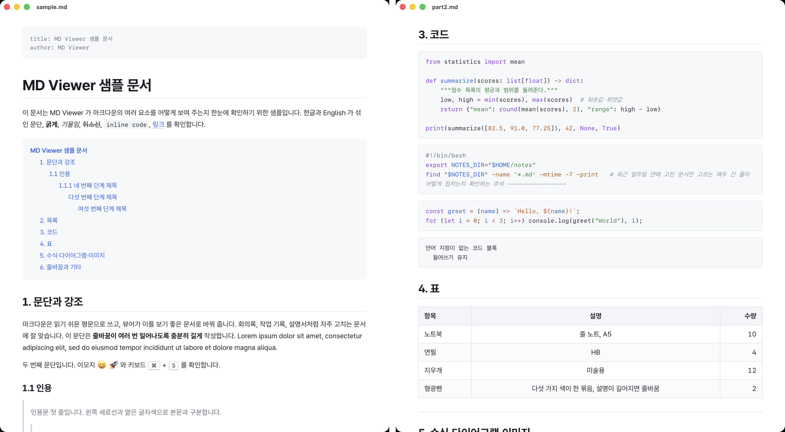
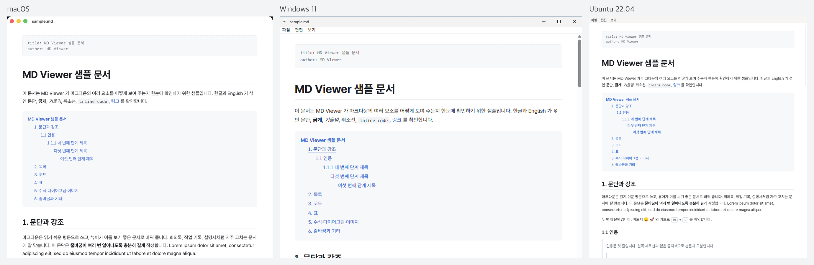
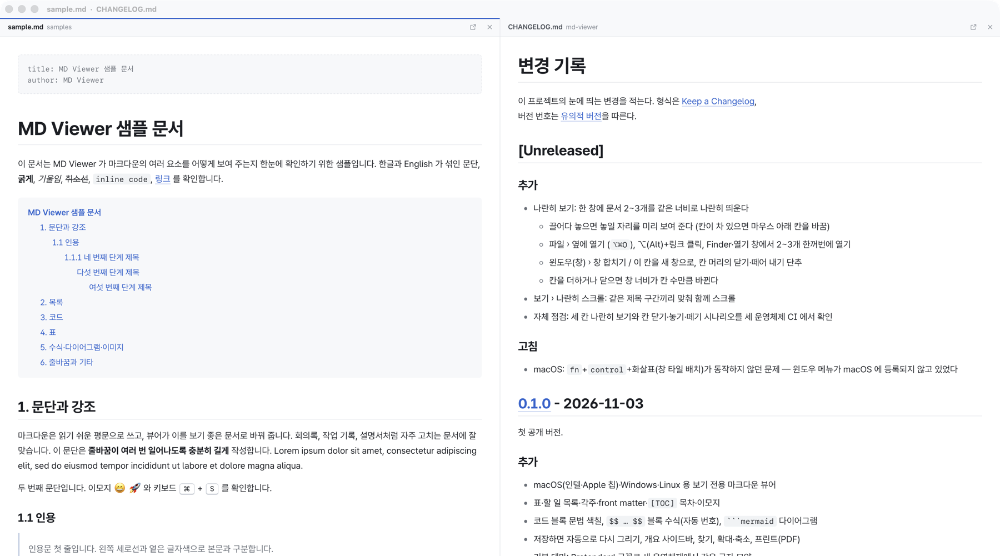

# MD Viewer

[](https://github.com/monojun/md-viewer/actions/workflows/build.yml)
[](https://github.com/monojun/md-viewer/releases/latest)
[](LICENSE)

마크다운(.md) 문서를 **읽기 좋은 문서 모양으로 보여 주는** 가벼운 앱. macOS·Windows·Linux 용.
보기 전용이 기본이고, 필요할 때 편집(⌘E)으로 전환해 저장할 수 있다. 다른 편집기에서 저장해도 열려 있는 창이 바로 다시 그려진다.



## 특징

- **보기 전용** — 문서를 실수로 고칠 일이 없다. 저장하면 자동으로 다시 그린다.
- **나란히 보기** — 한 창에 문서 2~3개를 반씩·삼분의 일씩 나란히 띄워 비교한다. '나란히 스크롤'을 켜면 같은 제목끼리 맞춰 함께 내려간다.
- **같은 모양, 세 운영체제** — 본문 글꼴(Pretendard)을 앱에 넣어 한글·영문이 어디서나 같은 모양이다.
  
- **문서에 필요한 것들** — 표, 할 일 목록, 각주, front matter, `[TOC]` 목차, 이모지, 코드 문법 색칠,
  `$$ … $$` 블록 수식(자동 번호), ```` ```mermaid ```` 다이어그램
- **가볍다** — 설치 파일 4~8MB. 운영체제에 들어 있는 웹 화면 엔진을 쓴다.

## 설치

[INSTALL.md](INSTALL.md) 에 운영체제별 명령이 있다. AI 도우미(Claude 등)에게 "github.com/monojun/md-viewer 설치해줘" 라고 해도 된다.
브라우저로 받으려면 [최신 Release](https://github.com/monojun/md-viewer/releases/latest) 에서:

| 운영체제 | 파일 |
|---|---|
| macOS 11+ (인텔·Apple 칩) | `…_universal.dmg` |
| Windows 10·11 (64비트) | `…_x64-setup.exe` |
| Linux (Ubuntu·Debian) | `…_amd64.deb` 또는 `…_amd64.AppImage` |

## 쓰는 법

- .md 파일을 더블클릭(기본 앱으로 지정한 경우)하거나, 우클릭 → 다음으로 열기(연결 프로그램) → MD Viewer
- 문서 안의 다른 .md 링크는 새 창으로(⌥/Alt+클릭하면 옆 칸으로), 웹 링크는 브라우저로 열린다.
- macOS 15 이상에서는 다른 앱처럼 `fn`+`control`+화살표로 창을 화면 왼쪽·오른쪽 절반 등에 배치할 수 있다.

| 키 (Windows·Linux 는 ⌘ → Ctrl, ⌥ → Alt) | 동작 |
|---|---|
| `⌘O` | 열기 (파일 › 최근 사용 도 있음) |
| `⌥⌘O` | 옆에 열기 (지금 창에 칸 추가, 최대 3개) |
| `⌘W` | 닫기 (칸이 여럿이면 지금 칸만) |
| `⇧⌘L` | 개요 사이드바 (현재 위치 표시, 누르면 이동) |
| `⌘F` / `⌘G` / `⇧⌘G` | 찾기 / 다음 / 이전 (Windows 는 `F3`·`⇧F3` 도 됨, `esc` 닫기) |
| `⌘=` `⌘-` `⌘0` | 확대 / 축소 / 실제 크기 (기억됨) |
| `⌘R` | 다시 읽기 (보통은 저장하면 자동 반영) |
| `⌘P` | 프린트 — 프린트 창에서 PDF 로 저장 |
| `⇧⌘R` | 파일이 있는 폴더 보기 |
| `⌘E` | 편집 모드 ↔ 보기 모드 (지금 칸) |
| `⌥⌘E` | 편집 칸으로 열기 (지금 문서를 편집 칸으로 하나 더) |
| `⌘S` / `⇧⌘S` | 저장 / 다른 이름으로 저장 (편집 중일 때) |

### 편집

처음에는 보기만 보여 주고, `⌘E` 로 편집기(CodeMirror 5)로 바꾼다.
- **저장 시 원본 꼴 보존** — UTF-8/UTF-16 BOM 과 CRLF/LF 줄바꿈, EUC-KR(CP949) 인코딩을 그대로 되살려 쓴다. "변경 없이 저장" 왕복은 바이트가 똑같다.
- **외부 변경 안전** — 편집 중에 파일이 바깥에서 바뀌면 자동으로 덮어쓰지 않고, 칸 위 안내바에서 "내 변경 지키기 / 디스크로 되돌리기" 를 고른다.
- **편집 UX 두 가지** — 보기 › 편집 UX 에서 고른다 (환경설정에 저장).
  - **토글 모드** (기본) — 한 번에 하나. `⌘E` 로 지금 칸을 통째로 편집기로 바꾸고, 다시 누르면 돌아온다.
  - **칸 모드** — 편집 칸과 보기 칸이 함께 있다 (`⌥⌘E` 로 편집 칸을 하나 더 띄운다). 편집 내용이 500ms 뒤 옆 보기 칸에 그려지고, 커서 위치를 따라 같은 소스 줄의 블록으로 함께 스크롤된다.

### 나란히 보기 (한 창에 2~3개)



- **끌어다 놓기** — 열린 창에 .md 파일을 끌어 오면 놓일 자리가 미리 보인다. 마우스 위치에 따라 왼쪽·사이·오른쪽에 칸이 생기고, 세 칸이 차 있으면 마우스 아래 칸을 바꾼다.
- **옆에 열기** — 파일 › 옆에 열기… (`⌥⌘O`)
- **한꺼번에 열기** — Finder·열기 창에서 2~3개를 함께 골라 열면 한 창에 나란히 열린다.
- **창 합치기** — 따로 열린 창들을 윈도우(창) › 창 합치기 로 한 창에 모은다. 반대로 칸 머리의 ↗ 단추나 이 칸을 새 창으로 로 떼어 낸다.
- 칸을 하나 더하거나 닫으면 칸 너비는 그대로 두고 창이 그만큼 넓어지거나 좁아진다 (화면보다 넓어지지는 않는다).
- 찾기·개요·폴더에서 보기·프린트·`⌘W` 는 마지막으로 누른 칸(머리에 파란 줄)에 적용된다.
- 보기 › 나란히 스크롤 — 한 칸을 스크롤하면 다른 칸도 같은 제목 구간의 같은 위치로 따라온다. 고친 판과 옛 판처럼 내용 길이가 달라도 같은 절끼리 맞는다.

### 마크다운 규칙

- 엔터 한 번도 화면에서 줄을 바꾼다.
- 문장 속 `$수식$`·`==형광펜==`·`~아래첨자~` 는 해석하지 않고 글자 그대로 둔다 (달러·물결표가 많은 일반 글이 깨지지 않게).
- 각주 정의(`[^1]: …`)는 문서 끝으로 모으지 않고 적힌 자리에 보여 준다.
- 문단에 그림 하나만 있으면 가운데 정렬. front matter 에 `root-url: ../assets` 를 쓰면 그림 경로의 기준 폴더가 된다.

## 개발

### 구조

```
web/                화면 — viewer.html · theme.css(문서 테마) · app.css(사이드바·찾기 막대) · fonts/
web/src/            markdown.js(해석 규칙) · highlight.js(코드 색) · viewer.js(렌더·개요·찾기·링크·앱 연결)
src-tauri/          앱 껍데기 (Rust) — src/main.rs(창·파일 읽기·감시·메뉴·링크) · tauri.conf.json(파일 연결·보안)
scripts/            build-web.mjs(web→dist 묶기) · dev-mac.sh(맥 로컬 빌드) · ci-selftest.*·check-selftest.mjs(자체 점검)
samples/sample.md   모든 요소가 들어 있는 샘플 (자체 점검 기준)
```

| 부분 | 쓴 것 |
|---|---|
| 앱 껍데기 | [Tauri 2](https://tauri.app) (Rust) — macOS WebKit · Windows WebView2 · Linux WebKitGTK |
| 마크다운 | markdown-it (+ 각주·할 일·이모지·front matter) |
| 코드 색칠 · 수식 · 다이어그램 | CodeMirror 5 토크나이저 · MathJax 3 (SVG) · Mermaid 11 — 수식·다이어그램은 쓰는 문서에서만 불러온다 |
| 편집기 | CodeMirror 5 (쓰는 Markdown 모드) — 코드 색칠과 같은 라이브러리를 그대로 쓴다 |
| 글꼴 | Pretendard (본문), 시스템 고정폭 글꼴 (코드) |

함께 들어간 공개 소프트웨어: [THIRD_PARTY_NOTICES.md](THIRD_PARTY_NOTICES.md)

### 빌드 (macOS)

[Rust](https://rustup.rs) 와 [Node.js](https://nodejs.org) 22 이상이 필요하다.

```bash
scripts/dev-mac.sh               # 이 맥의 칩용 .app
scripts/dev-mac.sh --universal   # 인텔·Apple 칩 겸용
scripts/dev-mac.sh --install     # 빌드 후 /Applications 에 설치
```

다른 운영체제는 `npm ci && npx tauri build` (Linux 는 [Tauri 준비물](https://tauri.app/start/prerequisites/) 먼저).

### 자체 점검

```bash
md-viewer --self-test samples/sample.md --report r.json   # 샘플을 그린 결과(제목·코드·수식·그림 수 등)를 JSON 으로 남기고 끝난다
node scripts/check-selftest.mjs r.json                    # 기준과 비교
md-viewer --self-test samples/sample.md --report r3.json samples/sample.md samples/sample.md   # 세 칸 나란히
node scripts/check-selftest.mjs r3.json "" 3
md-viewer --self-test samples/sample.md --report rs.json --scenario other.md   # 칸 닫기 → 끌어다 놓기 → 새 창으로 떼기
md-viewer --self-test samples/sample.md --roundtrip --report rt.json           # 편집 → 저장 왕복이 바이트 동일한지 (화면 없이)
```

편집 기능의 바이트 왕복 보존(BOM·CRLF·인코딩)은 `cargo test` 로도 확인한다:

```bash
cd src-tauri && cargo test   # decode_full / encode_full 왕복 검사 9가지
```

CI(GitHub Actions)는 세 운영체제에서 빌드한 뒤 앱을 실제로 띄워 이 세 가지 점검을 하고, 화면 캡처를 함께 남긴다 (`scripts/ci-selftest.*`).

앱 로그: macOS `~/Library/Logs/io.github.monojun.mdviewer/` · Windows `%LOCALAPPDATA%\io.github.monojun.mdviewer\logs\` · Linux `~/.local/share/io.github.monojun.mdviewer/logs/`

### 릴리스

1. `package.json` · `src-tauri/Cargo.toml` · `src-tauri/tauri.conf.json` 의 version 을 함께 올린다 ([유의적 버전](https://semver.org/lang/ko/)).
2. [CHANGELOG.md](CHANGELOG.md) 에 바뀐 점을 적는다.
3. 커밋 후 `git tag v0.1.1 && git push origin main v0.1.1` — Actions 가 세 운영체제 설치 파일을 만들어 Release 에 올린다.

## 알려진 제약

- 화면은 밝은 테마 하나뿐이다 (다크 모드에서도 밝게 보인다).
- 오래된 Linux(WebKitGTK 2.44 미만)에서는 찾기 결과 색 표시가 안 되고 개수·이동만 된다.
- 코드 서명을 하지 않아서, 브라우저로 받은 설치 파일은 처음 실행할 때 운영체제 경고가 뜬다 ([INSTALL.md](INSTALL.md) 참고).

## 라이선스

[MIT](LICENSE)
