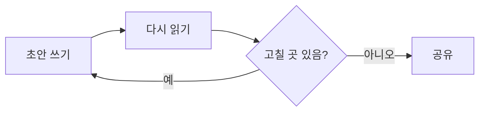

# MD Viewer 샘플 문서

이 문서는 MD Viewer 가 마크다운의 여러 요소를 어떻게 보여 주는지 한눈에 확인하기 위한 샘플입니다. 한글과 English 가 섞인 문단, **굵게**, *기울임*, ~~취소선~~, `inline code`, [링크](https://commonmark.org) 를 확인합니다.

[TOC]

## 1. 문단과 강조

마크다운은 읽기 쉬운 평문으로 쓰고, 뷰어가 이를 보기 좋은 문서로 바꿔 줍니다. 회의록, 작업 기록, 설명서처럼 자주 고치는 문서에 잘 맞습니다. 이 문단은 **줄바꿈이 여러 번 일어나도록 충분히 길게** 작성합니다. Lorem ipsum dolor sit amet, consectetur adipiscing elit, sed do eiusmod tempor incididunt ut labore et dolore magna aliqua.

두 번째 문단입니다. 이모지 :smile: :rocket: 와 키보드 <kbd>⌘</kbd> + <kbd>S</kbd> 를 확인합니다.

### 1.1 인용

> 인용문 첫 줄입니다. 왼쪽 세로선과 옅은 글자색으로 본문과 구분합니다.
>
> > 중첩된 인용문입니다.

#### 1.1.1 네 번째 단계 제목

##### 다섯 번째 단계 제목

###### 여섯 번째 단계 제목

## 2. 목록

- 순서 없는 목록 항목
- 두 번째 항목
  - 들여쓴 하위 항목
  - 하위 항목 둘
    - 세 번째 깊이
- 세 번째 항목

1. 순서 있는 목록
2. 두 번째
   1. 하위 번호
   2. 하위 번호 둘
3. 세 번째

- [x] 완료된 할 일
- [ ] 아직 안 한 할 일
- [ ] 또 하나

## 3. 코드

```python
from statistics import mean

def summarize(scores: list[float]) -> dict:
    """점수 목록의 평균과 범위를 돌려준다."""
    low, high = min(scores), max(scores)  # 최솟값·최댓값
    return {"mean": round(mean(scores), 2), "range": high - low}

print(summarize([82.5, 91.0, 77.25]), 42, None, True)
```

```bash
#!/bin/bash
export NOTES_DIR="$HOME/notes"
find "$NOTES_DIR" -name '*.md' -mtime -7 -print   # 최근 일주일 안에 고친 문서만 고르는 매우 긴 줄이 어떻게 접히는지 확인하는 주석 ----------------
```

```javascript
const greet = (name) => `Hello, ${name}!`;
for (let i = 0; i < 3; i++) console.log(greet("World"), i);
```

```
언어 지정이 없는 코드 블록
  들여쓰기 유지
```

## 4. 표

| 항목 | 설명 | 수량 |
| :--- | :---: | ---: |
| 노트북 | 줄 노트, A5 | 10 |
| 연필 | HB | 4 |
| 지우개 | 미술용 | 12 |
| 형광펜 | 다섯 가지 색이 한 묶음, 설명이 길어지면 줄바꿈 | 2 |

---

## 5. 수식·다이어그램·이미지

$$
f(x) = \frac{1}{\sigma \sqrt{2\pi}} \exp\left( -\frac{(x-\mu)^2}{2\sigma^2} \right), \qquad \int_{-\infty}^{\infty} f(x)\,dx = 1
$$




각주가 붙은 문장입니다.[^1]

[^1]: 각주 내용입니다. 정의는 적어 둔 자리에 그대로 보입니다.

## 6. 줄바꿈과 기타

첫 줄 다음에 엔터 한 번
둘째 줄 (한 줄 바꿈)

인라인 수식 $E=mc^2$ 과 ==형광펜== 과 H~2~O 는 글자 그대로 보입니다.

<u>밑줄</u> 과 <span style="color:#c0392b">빨간 글씨</span> HTML 태그.
